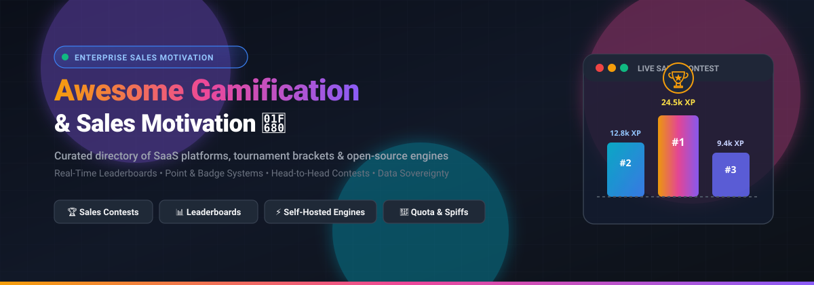

# 🏆 Awesome Gamification & Sales Motivation 🚀

  

  
  
  
  
  
  
  

---

## 🌟 Top Gamification & Sales Motivation Ecosystem

**Curated Directory of Enterprise SaaS Platforms & Open-Source Motivation Engines**  
*Focused on Sales Contests, Real-Time Leaderboards, Head-to-Head Brackets & Self-Hosted Gamification Infrastructure*  
**📅 Last updated: March 2026**

This repository tracks notable **SaaS platforms** and **open-source projects** designed for **Gamification & Sales Motivation**. Revenue operations and sales engineering teams utilize these tools to drive rep motivation, track CRM quota attainment, launch dynamic TV leaderboards, run bracket competitions, and embed game mechanics (XP, points, levels, challenges, badges) into enterprise applications.

---

## 📑 Table of Contents
- [📈 Sector Overview & Market Dynamics](#-sector-overview--market-dynamics)
- [🏢 SaaS/Hosted Platforms](#-saashosted-platforms)
- [💻 Open-Source GitHub Projects](#-open-source-github-projects)
- [🤝 How to Contribute](#-how-to-contribute)
- [💖 Support & Sponsorship](#-support--sponsorship)
- [📊 Star History](#-star-history)
- [⚖️ Disclaimer](#-disclaimer)

---

## 📈 Sector Overview & Market Dynamics

The global enterprise gamification market is valued at approximately **$26B–$29B in 2025** and is projected to reach **$32B–$36B in 2026** (~25% CAGR), with dedicated sales gamification and performance management software accounting for **~$4.4B**. The industry is **moderately fragmented**: rather than a single winner-take-all monopoly, the landscape is partitioned across major enterprise CRM suites (e.g., Zoho, Salesforce) providing baseline point and leaderboard gamification, specialized seller activation & coaching platforms (Ambition, Centrical, LevelEleven), and self-hosted developer-friendly open-source frameworks.

---

## 🏢 SaaS/Hosted Platforms

| Product | Company Scale (Revenue / Valuation) | Pricing (Starting Tier) | Free Tier / Trial Limits | Description |
|---------|------------------------------------|-------------------------|--------------------------|-------------|
| **[Zoho Gamescope](https://www.zoho.com/crm/performance/gamification.html)** | **~$1.4B–$1.5B revenue** (FY25) / ~$12.5B estimated valuation | **$14/user/month** (Standard plan, annual billing; Gamescope included with Zoho CRM) | **Free forever plan** available for up to 3 users, 5,000 records, and 1 GB storage (bundled with Zoho CRM Free Edition) | **Gamification within Zoho CRM.** Earn badges and trophies for daily activities—quick follow-ups, lead conversion, deal closures. **Sales reps don't need manager approval to start a game**—they choose opponents or form teams. Popup notifications track progress toward goals. |
| **[Centrical](https://centrical.com/)** | **~$100M raised** / ~$25M+ ARR band; enterprise valuation in several hundred million range | **$50,000/year base deployment** (flat annual license per user + pooled AI usage credits) | **No self-service free tier or trial** (custom proof-of-concept / guided enterprise pilot via sales) | **AI performance platform for retail and sales teams.** Gamified goals, peer challenges, and store-level competitions paired with microlearning and coaching. **Documented outcomes**: 27% increase in protection plan attach rates, 32% boost in TV sales, and 19% increase in sales for highly active users. |
| **[Playvox](https://www.playvox.com/)** | **Acquired by NICE** (NICE: ~$2.6B+ revenue / ~$10B market cap); historical ARR ~$33M–$75M | **$15–$30/user/month** (core module starting tier; scales to $90/user/month for full WEM suite) | **No free tier** (guided custom demo / scoped enterprise pilot available upon request; no self-serve trial) | **Quality management with gamification for support teams.** Points, rewards, and badges based on quality scores and coaching sessions. **Karma store** for incentives; community tab for peer recognition. Zendesk Marketplace integration available. |
| **[Ambition](https://ambition.com/)** | **~$11.5M ARR** / $21.2M total venture funding (Primus Capital) | **$40–$45/user/month** (Activate tier, billed annually; ~$6,800/year minimum deployment) | **No free tier** (structured 14-day to 30-day proof-of-concept pilot available via sales inquiry) | **AI-powered seller activation platform that goes beyond traditional gamification.** **Bracket Competitions (March 2026)** pair head-to-head matchups with coaching, accountability, and org-wide visibility—tied to high-value behaviors like meetings set or pipeline created, not just activity for activity's sake. CEO Jared Houghton states "gamification as we know it is broken"—Ambition embeds competition inside a broader execution system. |
| **[LevelEleven (Ascent Cloud)](https://www.ascentcloud.io/)** | **~$8.5M–$9.5M revenue** (Ascent Cloud) / $7.5M VC raised prior to merger | **$45/user/month** (Motivate tier, billed annually; full Coach tier at $55–$60/user/month) | **No free tier or public self-serve trial** (test environment / customized walkthrough available via sales demo) | **Sales motivation and coaching platform.** **Brackets (March 2026)**: tournament-style, head-to-head competitions (4–64 users) built natively inside LevelEleven, powered by CRM data with **no custom development**. Managers spin up a tournament in minutes; reps see "You vs. one rival" rather than a distant leaderboard rank. |
| **[Hoopla](https://hoopla.net/)** | **Acquired by Raydiant** ($54.4M total funding; Raydiant assets acquired by Displai in 2025) | **$25/user/month** (base software tier; scales to $50/user/month depending on broadcast feeds) | **30-day free trial** with full platform feature access and live broadcast support; no permanent free tier | **Gamification via dynamic TV broadcasts and CRM-connected leaderboards.** Connects directly to Salesforce, HubSpot, and other CRMs to broadcast live metrics—YTD revenue, pipeline, meetings booked, and live call battles. **Newsflashes** trigger on closed deals or quota hits, pushing recognition to Slack and Microsoft Teams. |
| **[Arcade](https://www.arcade.co/)** | **~$4.6M revenue** / $9M total venture funding (Stage 2 Capital, OIF Ventures) | **$15/user/month** (workplace engagement base tier; custom tiered enterprise contracts from $5,000/year) | **No permanent free tier** (guided pilot program and interactive demo environment available via sales) | **AI-powered sales training and gamification.** Turns top performers into coaches and managers into multipliers—peer-to-peer learning at scale. **150,000+ hours of sales roleplay completed**, **40%+ improved new hire retention**. Positioned for retail and field sales enablement. |
| **[Spinify](https://spinify.com/)** | **~$3.3M ARR** / Bootstrapped & founder-led | **$25/user/month** (Business tier, billed annually with 5-user minimum; $18/user/month Real Estate tier) | **14-day free trial** (unlimited access to leaderboards and AI agents, no credit card required); no permanent free tier | **Sales gamification with real-time leaderboards and TV displays.** **Per-user pricing**; administrators require additional licenses to create content, but **Fans have free access to view competitions** without participating. **No hidden fees**—pricing includes all features, integrations, and support. |
| **[SmartWinnr](https://smartwinnr.com/)** | **~$3.2M ARR** / Bootstrapped & privately held | **$10/user/month** (AppExchange base starting tier; custom enterprise contracts for AI roleplays) | **No self-service free trial or free tier** (personalized product walkthrough and custom proof-of-concept via sales) | **Sales excellence platform combining AI roleplays, gamified microlearning, and sales contests.** Gartner Peer Insights: annual revenue **$50M–$250M**, 51–200 employees. Customers report scaling across **25 countries in 12 languages** with fast ROI. |
| **[Gametize](https://gametize.com/)** | **~$1M ARR band** / Bootstrapped ($133K early seed funding) | **$45/month** (Starter tier, up to 50 players; Regular tier at $180/month for 200 players) | **Free forever plan** capped at 1 project and up to 10 players with core gamification features (points, badges, leaderboards) | **Gamification platform for community engagement, learning, and sales training.** Create games in **5 minutes with zero coding**—quizzes, predictions, photo challenges, and more. Points, badges, and rewards awarded for every interaction. |

---

## 💻 Open-Source GitHub Projects

Self-hosted gamification backends, motivation engines, and community-driven sales leaderboard frameworks—ideal for teams demanding full data ownership and avoiding recurring per-seat SaaS costs. Repositories are sorted by GitHub Star counts in descending order.

| Project | Stars | Tech Stack / License | Description |
|---------|:-----:|----------------------|-------------|
| **[GitScrum](https://github.com/gitscrum-core/laravel-gitscrum)** |  | PHP / Laravel (GPL-3.0) | **Gamified project and sprint execution tool.** Combines agile workflows with gamified task completion, badges, effort estimation, and performance leaderboards for sales and product teams. |
| **[SkillTree](https://github.com/NationalSecurityAgency/skills-service)** |  | Java / Spring Boot / Vue.js (Apache-2.0) | **Micro-learning and skill-progression gamification platform created by the NSA.** Provides complete REST APIs for skill definitions, achievements, points, levels, and team leaderboards ready to plug into internal sales or ops portals. |
| **[laravel-gamify](https://github.com/qcod/laravel-gamify)** |  | PHP / Laravel (MIT) | **Reputation points and achievements engine for Laravel applications.** Easily add reputation points, define custom badge criteria, and generate real-time leaderboards for sales reps or community contributors. |
| **[Level-Up](https://github.com/cjmellor/level-up)** |  | PHP / Laravel (MIT) | **Gamification package featuring XP, level progression, and dynamic leaderboards.** Integrates directly into database models to award XP for deals closed, milestone achievements, and leaderboard rankings. |
| **[gengine (Gamification Engine)](https://github.com/ActiDoo/gamification-engine)** |  | Python / Flask / PostgreSQL (MIT) | **High-performance gamification rules engine.** Process events and trigger rewards, progression bars, achievements, and leaderboard calculations with low latency via REST APIs. |
| **[Gioco](https://github.com/joaomdmoura/gioco)** |  | Ruby on Rails (MIT) | **Gamification engine gem for Ruby on Rails.** Easily define badges, types, points systems, and leaderboard rankings with minimal configuration. |
| **[Meeds DAO](https://github.com/meeds-io/meeds)** |  | Vue.js / Java / Docker (LGPL-3.0) | **Open-source community engagement and recognition platform.** Gamification module awards points for team achievements; Kudos enables peer-to-peer recognition; token reward engine converts points into redeemable rewards. |
| **[Gamification Server](https://github.com/ngageoint/gamification-server)** |  | Java / Spring Boot (Apache-2.0) | **Microservice for tracking gamification elements (points, badges, tags, and leaderboards).** Built by the NGA to provide open gamification APIs that attach to any existing business app or CRM workflow. |
| **[django-gamification](https://github.com/mattjegan/django-gamification)** |  | Python / Django (BSD-2-Clause) | **Gamification toolkit for Django apps.** Adds points, badges, progress unlockables, and dynamic rank ladders for users with clean ORM integration. |
| **[Trophy UI](https://github.com/trophyso/ui)** |  | React / TypeScript / TailwindCSS (MIT) | **Open-source gamification frontend components.** Pre-built React components for leaderboard tables, achievement toasts, streak counters, and reward badges. |
| **[ohcnetwork/leaderboard](https://github.com/ohcnetwork/leaderboard)** |  | TypeScript / Next.js (MIT) | **Plugin-based open-source activity leaderboard.** Multiple views (leaderboards, profiles, timelines), static export capabilities, and an MCP server for querying rep rankings with AI assistants. |
| **[Gami.Fied](https://github.com/gami-fied/gami.fied)** |  | TypeScript / Node.js (MIT) | **Self-hostable gamification infrastructure with an isomorphic TypeScript SDK.** Native primitives for XP ledgers, audit trails, rank leaderboards, multi-step quests, and webhooks with zero runtime dependencies. |
| **[GAME (Goals And Motivation Engine)](https://github.com/fvergaracl/GAME)** |  | Python / FastAPI / PostgreSQL (MIT) | **Complete open-source motivation and goal engine.** Features Keycloak RBAC authentication, points-to-coins conversion, Kubernetes deployment manifests, and Docker images. |
| **[Odoo CRM Gamification](https://github.com/alexmalab/odoo_addons/blob/723c057910d8a7e083f5ce28258064a13c6e2e34/Sales/CRM/gamification_sale_crm.md)** |  | Python / Odoo (LGPL-3.0) | **Native CRM gamification module for Odoo.** Defines goal definitions and challenges tied directly to CRM data: total invoices, new leads, lead qualification time, and days to close a deal. |

---

## 🤝 How to Contribute

Contributions are welcome! Help us keep this directory up-to-date with new SaaS platforms, features, pricing tiers, and open-source motivation engines:

1. 🍴 **Fork the repository**.
2. 🌿 **Create a new branch**: `git checkout -b add-gamification-tool`.
3. 📝 **Add or update entries** in `README.md` following the existing format.
4. 💡 **Include essential details**: Name, official link, transparent pricing / free-tier limits (for SaaS), star count badge (for open source), and factual description.
5. 🚀 **Submit a Pull Request** with a concise explanation.

---

## 💖 Support & Sponsorship

If you find this curated ecosystem helpful for your sales operations, engineering team, or research:

- ⭐ **Star this repository** to help others discover it!
- 🍴 **Fork and share** with colleagues in RevOps, Sales Enablement, and Software Engineering.
- ☕ **Support continuous updates and maintenance**: Buy me a coffee via the [GitHub Sponsors Dashboard](https://github.com/sponsors/ishandutta2007).

Your sponsorship and stars keep this project actively maintained, thoroughly researched, and open for the community!

---

## 📊 Star History

---

## ⚖️ Disclaimer

- This is a **community-curated** list — not exhaustive and not an official vendor endorsement.
- Gamification platforms handle employee performance data and potentially sensitive behavioral metrics; ensure transparent guidelines, avoid gamifying metrics that incentivize counter-productive behavior, and comply with all applicable employment regulations.
- **Sales gamification is evolving beyond simple points and leaderboards.** Bracket-style competitions tied to coaching, pipeline creation, and real CRM outcomes are rapidly replacing static leaderboards.
- **Validate your infrastructure requirements**: Decide whether you require an all-in-one turnkey SaaS platform (Ambition, Spinify, Hoopla) or a self-hosted engine (GAME, Gami.Fied, SkillTree, GitScrum) for complete data sovereignty before committing resources.

---

  <b>Built for sales leaders, revenue operations teams, and developers engineering motivation systems.</b> 
  Let's make gamification and sales motivation more open, transparent, and performance-driven.

